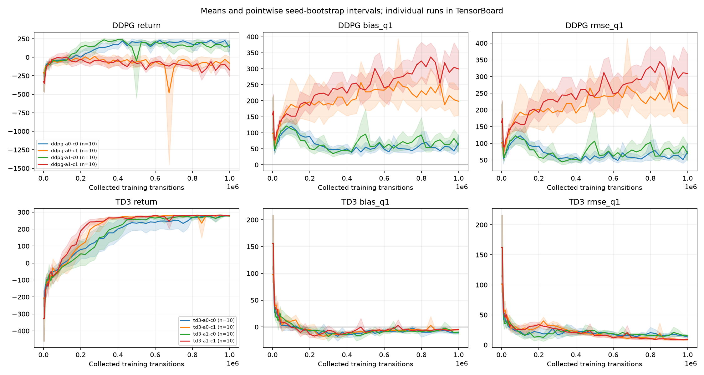
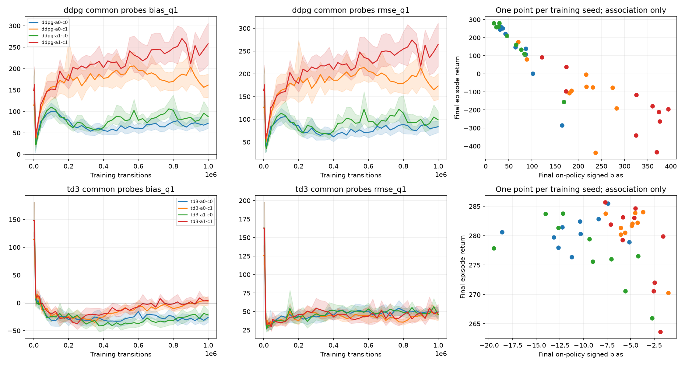

# MAC — Stage A — 20261008

Platform-labelled results: **80 completed runs**, eight DDPG/TD3 × actor-LN ×
critic-LN conditions, ten training seeds (20–29) per condition, **1,000,000 steps
per run**. CPU, eight independent workers, one Torch/BLAS thread per worker.
Scientific preparation revision: `6513820281b187017cac02c0bd8f4f825712e809`. Stage B is not included.

## Results





Final held-out episode returns and signed Q1-minus-Monte-Carlo bias:

| Condition (`a`: actor LN, `c`: critic LN) | Mean return | Return SD across seeds | Mean signed bias |
|---|---:|---:|---:|
| ddpg-a0-c0 | 135.2 | 170.0 | 67.2 |
| ddpg-a0-c1 | -79.8 | 162.3 | 198.3 |
| ddpg-a1-c0 | 165.2 | 131.8 | 62.1 |
| ddpg-a1-c1 | -171.0 | 159.9 | 299.3 |
| td3-a0-c0 | 280.6 | 2.6 | -11.0 |
| td3-a0-c1 | 281.0 | 4.0 | -4.9 |
| td3-a1-c0 | 277.1 | 5.6 | -9.6 |
| td3-a1-c1 | 278.4 | 7.2 | -4.4 |

Each mean averages ten training seeds. Returns use 20 held-out evaluation episodes;
positive bias means overestimation. SD describes seed variation, not confidence
interval width. Plots show pointwise seed-bootstrap intervals. Prespecified paired
contrasts, bootstrap intervals and Holm-adjusted p-values are in
[analysis/summary.json](analysis/summary.json). These results do not establish that
bias causes poor performance.

## Included here

- [Learning/checkpoint scalar metrics](learning_metrics.csv): every saved checkpoint
  for every seed, explicitly labelled `mac`. `common_probe_analysis_rmse`
  matches the analysis's root-mean-square of episode RMSEs.
- [Per-seed outcomes and active timing](seed_summary.csv), [condition table](conditions.csv).
- PDF/PNG figures and complete aggregate statistical analysis under `analysis/`.
- Original manifest, probe bank, platform comparison and SHA-256 file inventory
  under `provenance/`. The original manifest retains the full planned A+B study;
  this publication exports only the 80 completed A jobs.

## Complete raw data on GitHub

[Download the **MAC Stage A release**](https://github.com/glouno/miniproject1-DDPG/releases/tag/results-mac-stage-a-20261008). Eight
condition archives each contain all ten seed directories, including raw Q/state/
action/return diagnostics, journals, inference checkpoints, latest/previous resume
states, TensorBoard records and job logs. A ninth archive contains frozen source,
locked environment/configs, analysis and provenance. No Stage B run data is uploaded.

Original Stage A runs plus analysis: **8,074,755,233 bytes**
(8.07 GB / 7.52 GiB).
Compressed archives: **6,971,902,846 bytes**
(6.97 GB).
These files are release assets rather than ordinary Git history. Repository and
release access remain private.

Download all nine archives and `SHA256SUMS` into one directory, then:

```sh
shasum -a 256 -c SHA256SUMS
for archive in mac-stage-a-20261008-*.tar.zst; do
  zstd -dc "$archive" | tar -xf -
done
```

They merge into `mac-stage-a-20261008/`. To regenerate the analysis without training:

```sh
cd mac-stage-a-20261008/source
/absolute/path/to/the/locked/.venv/bin/python -m lunarlander_rl.followup_analyse \
  --input /absolute/path/to/mac-stage-a-20261008 --stage A
```

Use the recorded package versions and frozen source; this is an analysis command,
not a training launch. Resume checkpoints are platform-specific. Mac Box2D probe
observations differ slightly from WSL; seeds/action prefixes match, while exact
physical replay is enforced within each platform. Do not pool these runs with
the WSL repetitions as additional independent training seeds.
