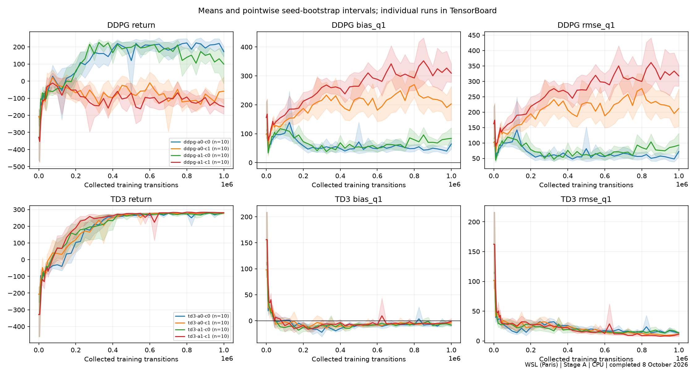
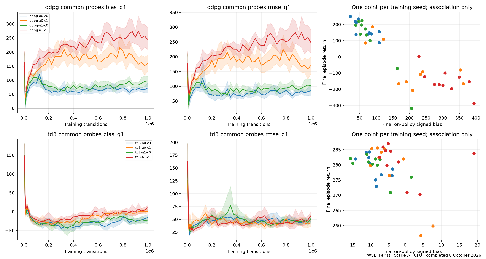
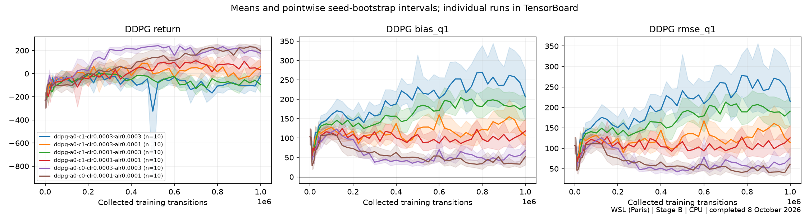
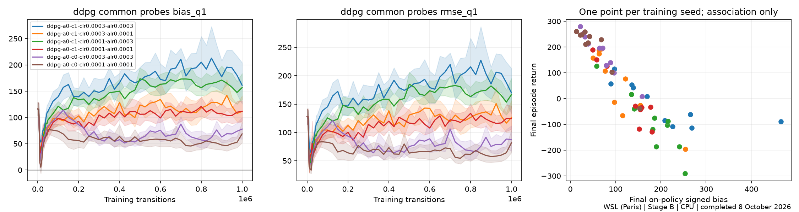

# WSL (Paris) — Stages A and B — 8 October 2026

**Data collected on Paris WSL (`paris-devbox-wsl`), CPU.** All **140 runs**
completed and passed validation: Stage A 80/80, Stage B 60/60. Each run collected
1,000,000 training transitions, for 140 million transitions total. Eight independent
workers, one Torch/BLAS thread per worker. Started 7 October 2026 at 23:57 Paris
time; finished 8 October at 22:20 (22 hours 23 minutes).
Scientific preparation revision: `be965b95edff62da79877c3a8b150071a1493ce2`.

These are WSL results, separate from the [Mac Stage A results](../../mac/stage-a-20261008/README.md).
Do not pool matching Mac and WSL seed indices as additional independent seeds.
Box2D observations can differ across platforms; frozen probe replay is validated
within the WSL environment. The original frozen manifest and hashes are preserved.

## Stage A: independent actor and critic LayerNorm

Ten training seeds (20–29) per condition. `a` denotes actor LN; `c` critic LN.

| Condition | Mean return | Seed SD | Mean signed Q1−MC bias |
|---|---:|---:|---:|
| ddpg-a0-c0 | 172.4 | 52.5 | 64.4 |
| ddpg-a0-c1 | -59.2 | 136.1 | 203.0 |
| ddpg-a1-c0 | 99.4 | 170.2 | 83.9 |
| ddpg-a1-c1 | -149.5 | 74.5 | 309.3 |
| td3-a0-c0 | 279.3 | 3.9 | -8.4 |
| td3-a0-c1 | 277.8 | 10.7 | -3.9 |
| td3-a1-c0 | 279.8 | 3.7 | -8.5 |
| td3-a1-c1 | 281.0 | 5.9 | -1.0 |

Critic LN reduced DDPG return with actor LN off by 231.6 points
(paired 95% seed-bootstrap interval −311.5 to −145.8; Holm-adjusted p=0.015625).
Adding actor LN with critic LN on did not show a reliable rescue (adjusted p=0.457).
TD3 remained strong across the four LN conditions; the primary LN return contrasts
were not significant. DDPG critic LN also showed large positive Q bias. These
observations do not establish that bias causes poor performance.





[Stage A complete statistics](analysis/A/summary.json).

## Stage B: fixed DDPG learning-rate interventions

Ten fresh training seeds (30–39) per condition. Actor LN is off throughout;
`clr` and `alr` are critic and actor learning rates. Four critic-LN-on cells form
the prespecified 2×2 learning-rate factorial; two LN-off controls support interpretation.

| Condition | Mean return | Seed SD | Mean signed Q1−MC bias |
|---|---:|---:|---:|
| ddpg-a0-c1-clr0.0003-alr0.0003 | -18.0 | 82.8 | 206.4 |
| ddpg-a0-c1-clr0.0003-alr0.0001 | 59.7 | 130.7 | 106.6 |
| ddpg-a0-c1-clr0.0001-alr0.0003 | -94.7 | 115.8 | 181.6 |
| ddpg-a0-c1-clr0.0001-alr0.0001 | 32.9 | 133.6 | 118.2 |
| ddpg-a0-c0-clr0.0003-alr0.0003 | 175.6 | 82.2 | 68.2 |
| ddpg-a0-c0-clr0.0001-alr0.0001 | 197.5 | 94.8 | 52.1 |

Lowering actor learning rate from 3e−4 to 1e−4, averaged over critic rates in
critic-LN-on runs, improved return by 102.6 points (paired 95% seed-bootstrap
interval 42.1 to 166.5). The raw sign-flip p=0.0215 becomes 0.0645 after Holm
correction across the three primary Stage B contrasts, above the 0.05 threshold.
Lowering critic learning rate had estimated effect −51.7 points (interval −124.3
to 25.3; adjusted p=0.441); the interaction was also inconclusive (adjusted p=0.592).
Slower actor learning reduced average Q overestimation descriptively, but LN-on
means remained below the LN-off controls. This does not identify a causal mechanism
or establish an optimal learning rate. All seeds, including poor outcomes, are retained.





[Stage B complete statistics](analysis/B/summary.json).

## Measurement and published files

Each return is an average of 20 held-out deterministic evaluation episodes
(maximum 1,000 steps), then averaged equally over ten training seeds. Seed SD
measures variation between training seeds, not confidence interval width.
Positive signed Q1−MC bias means overestimation of discounted Monte Carlo return.
Training seed is the experimental unit. Plot bands are pointwise seed-bootstrap
intervals; paired sign-flip tests assume symmetry/exchangeability.

- [Learning metrics](learning_metrics.csv): 6,860 checkpoints, every row labelled
  `platform=wsl`, with stage, condition, seed and both learning rates.
- [Seed outcomes and timing](seed_summary.csv): 140 labelled final outcomes.
- [Condition summaries](conditions.csv): all 14 conditions, labelled by platform and stage.
- `analysis/A/` and `analysis/B/`: WSL-labelled PNG/PDF plots and JSON statistics.
  Statistics regenerated from frozen source match the original analyses exactly
  before platform metadata is added.
- `provenance/`: unchanged manifest, probe bank, launch record, final status,
  explicit WSL platform record and complete raw-file SHA-256 inventory.
- [Publication metadata](publication.json), [verification](verification.json),
  [archive checksums](SHA256SUMS).

## Complete raw data and checkpoints

[Download the WSL Stages A+B release](https://github.com/glouno/miniproject1-DDPG/releases/tag/results-wsl-stages-a-b-20261008).
Fourteen condition archives include every seed's raw diagnostic arrays, metric and
optimization journals, audits, inference checkpoints, latest/previous full resume
states, TensorBoard records and job logs. A fifteenth provenance archive contains
frozen source/configs/lock, probes, original analyses and remaining original records.
All original files except the ephemeral runner lock are archived. Original source
and raw analyses remain unmodified; only the published figures carry added labels.
Every archived file is read back and checked against its original byte count and SHA-256.
Large raw data belong in release assets, not ordinary Git history. Access remains private.

Download all fifteen `.tar.gz` archives and `SHA256SUMS` into one directory:

```sh
sha256sum -c SHA256SUMS
for archive in wsl-stages-a-b-20261008-*.tar.gz; do
  tar -xzf "$archive"
done
```

They merge into `wsl-stages-a-b-20261008/`. Regenerate original analysis with
the locked dependencies and frozen source, without retraining:

```sh
cd wsl-stages-a-b-20261008/source
/absolute/path/to/the/locked/.venv/bin/python -m lunarlander_rl.followup_analyse --input /absolute/path/to/wsl-stages-a-b-20261008 --stage A
/absolute/path/to/the/locked/.venv/bin/python -m lunarlander_rl.followup_analyse --input /absolute/path/to/wsl-stages-a-b-20261008 --stage B
```

Resume checkpoints are platform-specific. Publication was prepared on 9 October
2026; the date in the folder and release refers to training completion.
