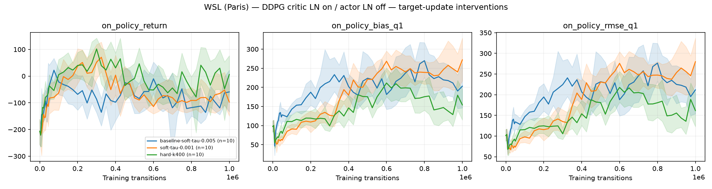
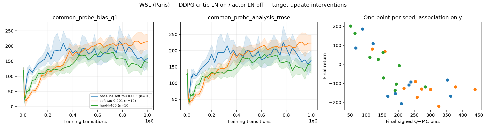

# WSL (Paris) — DDPG target-update results — 10 October 2026

**Collected on Paris WSL (`paris-devbox-wsl`), CPU.** All 20 new runs completed
and passed validation. Ten seeds (20–29) per condition, 1,000,000 transitions per
run, eight workers with one Torch/BLAS thread each. Finished 10 October 2026 at
04:02 Paris time after 3 hours 13 minutes.

DDPG critic LayerNorm on, actor LayerNorm off. Numerical settings match Mac
Stage A, except the requested target update intervention. The comparison baseline
is the existing **WSL Stage A** `ddpg-a0-c1` condition, not the Mac runs.
These are exploratory follow-ups selected after seeing Stage A/B; the historical
baseline is reused and must not be counted as new training data.

| Target update | Final return mean | Seed SD | Mean signed Q1−MC bias |
|---|---:|---:|---:|
| Historical WSL baseline: soft τ=0.005 | −59.2 | 136.1 | +203.0 |
| Soft τ=0.001 | −97.0 | 96.8 | +272.0 |
| Hard copies every 400 critic updates | 6.1 | 116.3 | +154.2 |

Both targets are updated together after the online optimizer steps. Hard mode
performs exact copies every 400 completed critic updates, with no interpolation
between copies; stored tau=0.005 is unused in that mode. Actor training cadence
and reward scale remain baseline. K=400 approximately matches the baseline's
average target age, not its update dynamics or the slower τ=0.001 condition.

Each reported return averages 20 held-out deterministic episodes, then ten training
seeds. Positive Q−MC bias means overestimation of discounted Monte Carlo return.
Seed SD measures training-seed variation, not confidence interval width.

Slower soft updates had lower mean return and greater overestimation. Hard copies
had a better mean return and lower mean bias, but substantial seed variation.
Neither exploratory paired return difference was conclusive:

| Difference versus WSL baseline | Mean difference | Paired 95% seed-bootstrap interval | Holm-adjusted p |
|---|---:|---:|---:|
| Soft τ=0.001 | −37.9 | [−127.5, +44.1] | 0.4844 |
| Hard K=400 | +65.2 | [−35.0, +156.9] | 0.4844 |

Changing the target schedule did not reliably resolve the critic-LN failure.
The hard-update trend is descriptive; it does not establish a benefit or a causal
mechanism. Sign-flip tests assume symmetry/exchangeability; seed is the experimental
unit. Bootstrap plot bands are pointwise. All seed outcomes are retained.





These are baseline-comparison plots generated by the frozen analysis code.
Exact live-report Figure 7 panel/layout matching has not been verified.

## Published tables and provenance

- [Learning metrics](learning_metrics.csv): 980 evaluation checkpoints, every row
  labelled `platform=wsl`, with condition, target mode, tau and hard-update interval.
- [Seed outcomes](seed_summary.csv): all 20 new runs, labelled WSL.
- [Condition summaries](conditions.csv) and [paired statistics](analysis/summary.json).
- Historical `baseline_*` CSVs retain their original WSL Stage A/B scope; the
  plotted baseline filters Stage A `ddpg-a0-c1` and seeds 20–29 only.
- `provenance/`: frozen manifest/hash, native probe bank, baseline manifest,
  launch verification, final status and full raw-file SHA-256 inventory.
- [Publication metadata](publication.json), [verification](verification.json),
  [archive checksums](SHA256SUMS).

## Complete raw data and checkpoints

[WSL target-update release](https://github.com/glouno/miniproject1-DDPG/releases/tag/results-wsl-target-updates-20261010).
Two condition archives preserve all ten seeds each: 980 model checkpoints total,
40 rolling recovery files, raw diagnostic trajectories, audits, optimization and
metric journals, TensorBoard records and worker logs. The third archive preserves
frozen source, configs, lock, original analyses, historical baseline tables and
remaining run records. Every original file except the ephemeral runner lock is
included; each archived file is read back and checked against its original size
and SHA-256. Raw data are release assets rather than ordinary Git history.

Download all three archives and `SHA256SUMS` into one directory:

```sh
sha256sum -c SHA256SUMS
for archive in wsl-target-updates-20261010-*.tar.gz; do
  tar -xzf "$archive"
done
```

Regenerate analysis without training, with the recorded dependencies:

```sh
cd wsl-target-updates-20261010/source
/absolute/path/to/the/locked/.venv/bin/python -m lunarlander_rl.target_runner --output /absolute/path/to/wsl-target-updates-20261010 --analyse
```

Keep WSL and Mac datasets separate. Full recovery is platform-specific; historical
model checkpoints support inference and further diagnostics, not historical replay
buffer/optimizer recovery.
